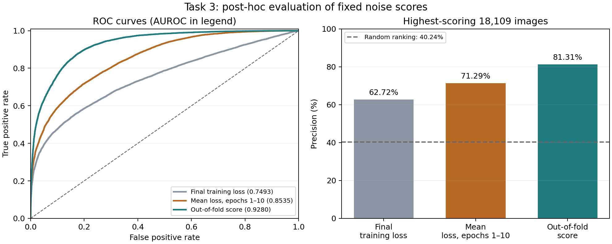

# Learning from Messy Human Labels

**Salaj Sonar · 24B2133**  
Inter-IIT Tech Meet 15.0 Selection Bootcamp — Computer Vision

This submission studies classification and label-error detection on the supplied CIFAR-10N data using the provided ResNet-18, trained from scratch.

## Submission contents

- [Report](report.md): answers to Q1–Q5.
- [Results](results.json): settings, methods and validation measurements.
- [Code and reproduction instructions](code/README.md): exact commands for all five tasks.
- [Predictions](predictions/): all ten required CSV files, including three robust methods.
- [Analysis](analysis/): plots, confusion statistics and experiment records.

The implementation uses Python scripts; a notebook is not required by the problem statement. No external datasets or pretrained weights are used.

## Main results

| Evaluation | Baseline | Selected method |
|---|---:|---:|
| Human-noisy validation accuracy | 55.94% | **58.06% (ELR)** |
| Synthetic-noisy validation accuracy | 49.88% | **53.26% (ELR)** |

Both comparisons use checkpoints selected on the corresponding noisy validation labels. Task 1 predictions use the final epoch as required. These values are not hidden-test accuracies.

The three-fold noise detector achieved **0.9280 AUROC** and **81.31% precision at 18,109** in the permitted post-hoc evaluation. Clean labels were not used to select models, filter training data, or choose the submitted scoring rule.

All five tasks passed the supplied format checker. See [code/README.md](code/README.md) for the environment, checkpoint rules and reproduction commands.
